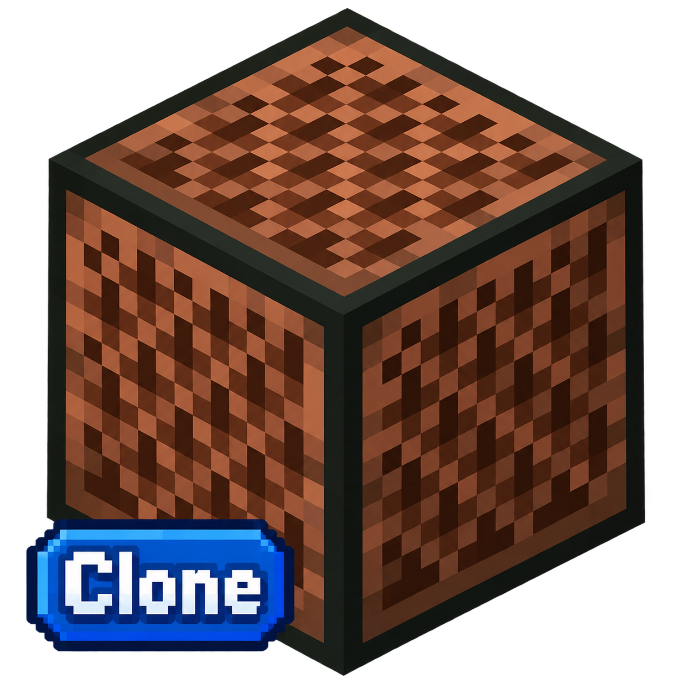
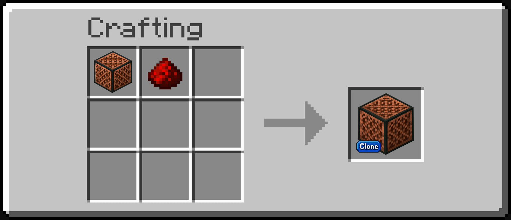
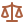

<details name="language" dir="ltr">
<summary> <a href="#!"></a> فارسی </summary>

<div dir="rtl">

# نوت بلاک کلون | NoteBlockClone

<p>
  
  
  <a href="CHANGELOG.md"></a>
  
  <a href="LICENSE"></a>
</p>

<p align="center">
  
</p>

---

## <a href="#!"></a> درباره پروژه

**NoteBlockClone** یک افزونه برای ماینکرافت بدراک است که یک **کلون تقریباً کامل از نوت بلاک** اصلی بازی می‌سازد — با همان بافت وانیلا، همان صداها، همان سازها و همان رفتار رداستونی؛ در یک شناسه‌ی جداگانه به‌محل بلوک اصلی.

همه چیز فقط با **API های رسمی و پایدار** (نسخه ۱٫۲۶+) پیاده‌سازی شده و **بدون هیچ Experiment ای** کار می‌کند.

> این پروژه در اصل پیش‌زمینه‌ای برای ساخت **Visual Noteblock Pitch (Bedrock)** بود: چون بدراک اجازه‌ی دستکاری رفتار نوت‌بلاک وانیلا را نمی‌دهد، ابتدا رفتار وانیلا در قالب NoteBlockClone بازسازی شد و سپس Visual Noteblock Pitch (Bedrock) از آن فورک شد.

> 🎵 اگر نمایشگر عدد گام روی وجه‌های بلوک را هم می‌خواهید، پروژه‌ی **Visual Noteblock Pitch (Bedrock)** را ببینید.

### <a href="#!"></a> چرا این افزونه؟

- <a href="#!"></a> هر چیزی که موتور وانیلا ارائه نمی‌دهد (به‌جز اسم/id) این‌جا طراحی شده: ساز، کوک، لبه صعودی رداستون
- <a href="#!"></a> امن برای مادپک‌ها: id جدا، دسترسی‌پذیر مستقل از تغییرات نسخه‌ی نوت بلاک وانیلا
- <a href="#!"></a> پیش‌زمینه‌ی آموزشی پاک‌سازی‌شده: جهت استفاده‌ی بعدی به‌عنوان برش‌گراف برای گام‌یابِ بصری

## <a href="#!"></a> ویژگی‌ها (دقیقاً مثل وانیلا)

| رفتار | نحوه پیاده‌سازی |
|---|---|
| پاسخ به رداستون | کامپوننت `minecraft:redstone_consumer` + هوک `onRedstoneUpdate` (از نسخه ۲۶ پایدار است) با تشخیص **لبه صعودی** سیگنال |
| تغییر ساز با بلوک زیرین | **۱۸ ساز** بر اساس بلوک زیرین — از جمله خانواده ترامپت مس (۴ مرحله اکسیداسیون) — خط‌به‌خط با minecraft.wiki |
| کوک کردن با کلیک | هوک کاستوم‌کامپوننت `onPlayerInteract` (بدون «بلوک شبح»)؛ چرخه گام ۰ → ۲۴ با صدا + پارتیکل — بدون هیچ متن اکشن‌باری |
| فرمول پیچ | `2^((note-12)/12)` — دو اکتاو کامل، دقیقاً مثل وانیلا |
| سکوت با بلوک رویی | اگر بالای بلوک هوا نباشد، صدایی پخش نمی‌شود |
| سر موب روی بلوک | صدای اسکلت، ویتر، زامبی، کریپر، اژدها و پیگلین |
| پارتیکل نُت | همان `minecraft:note_particle` وانیلا با جریان دادن `note_color` — رنگ طیف نُت (فرمول سینوسی جاوا) |
| شنوایی تا ~۴۸ بلاک | `volume: 3.0` مثل وانیلا |
| هدایت رداستون مثل بلوک معمولی | `redstone_conductivity` + `propagates_power: true` |
| حرکت‌ناپذیر با پیستون | `minecraft:movable` با `immovable` (مثل جاوا) |
| ذخیره شدن نُت | دو استیت `clone:octave` (۰–۱) + `clone:semitone` (۰–۱۲) با رمزنگاری `pitch = octave×13 + semitone` — بدون دیتابیس |

### <a href="#!"></a> سالم و پایدار

* فقط کامپوننت‌ها و هوک‌های **Stable** (بدون Experiment)
* تست خودکار: ۱۲۴ کیس تشخیص ساز + چرخه‌ی گام — سبز ✓

## <a href="#!"></a> نصب و استفاده

1. فایل دانلودشده‌ی `NoteBlockClone - V1.1.0 - 1.26+.mcaddon` را باز کنید — بازی هر دو پک را وارد می‌کند
2. در تنظیمات جهان، هر دو پک **Note Block Clone (Behavior)** و **(Resources)** را فعال کنید — Experiments لازم نیست
3. بلوک را از تب **Items** بردارید یا با دستور بگیرید:

```text
/give @s clone:noteblock_clone
```

4. در بقا هم با **۱ نوت‌بلاک وانیلا + ۱ رداستون** ساخته می‌شود.

<p align="center">
  
</p>
<p align="center"><sub>رسپی ساخت: ۱ نوت‌بلاک وانیلا + ۱ رداستون</sub></p>

<details>
  <summary style="font-weight: bold; font-size: 1.5em;">
    <a href="#!"></a> توضیحات بیشتر
  </summary>

## <a href="#!"></a> محدودیت‌های شناخته‌شده

* **لود چانک صدا نمی‌دهد:** `onRedstoneUpdate` هنگام لود چانک هم فایر می‌شود؛ ما عمداً اولین رویداد را فقط «ثبت» می‌کنیم (رفتار وانیلا هم همین است)
* **تشخیص ساز تقریبی است:** بازی API ای برای «متریال» ندارد؛ بلوک‌های ماد ممکن است پیش‌فرض (هارپ) شوند — تابع `getInstrument` قابل توسعه است
* **`minecraft:instrument_sound` عمداً استفاده نشده:** آن کامپوننت برای «بلوک‌های دیگر» است نه رفتار نوت بلاک؛ ما منطق را در اسکریپت پیاده کردیم که دقیق‌تر و بدون Experiment است
* **نسخه بازی:** نیازمند Minecraft Bedrock **26.0+** (موتور `1.26.x`)

## <a href="#!"></a> ساختار پروژه

```text
NoteBlockClone/
├── packs/
│   ├── NoteblockCloneBP/        # Behavior Pack
│   │   ├── manifest.json
│   │   ├── blocks/note_block_clone.json    # definition + components
│   │   ├── recipes/note_block_clone.json   # 1 note block + redstone
│   │   └── scripts/main.js      # tuning, redstone, instruments, particles
│   └── NoteblockCloneRP/        # Resource Pack
│       ├── manifest.json
│       ├── textures/blocks/     # vanilla note block texture
│       └── texts/
├── docs/                        # icon + README SVGs + recipe GIF
├── CHANGELOG.md                 # bilingual release notes
└── LICENSE                      # MIT
```

</details>

---

## <a href="#!"></a> منابع

* مستندات `minecraft:redstone_consumer` و `BlockCustomComponent.onRedstoneUpdate` — Microsoft Learn
* راهنمای Redstone Components — wiki.bedrock.dev
* جدول سازها + اینفوباکس «Note block instrument» هر بلوک — minecraft.wiki
* فایل رسمی پارتیکل نُت `particles/note.json` (متغیر `note_color`) — ریپوی Mojang/bedrock-samples

---

## <a href="#!"></a> مشارکت در پروژه

اگر پیشنهادی برای بهبود دارید یا با مشکلی روبه‌رو شدید، از طریق **Issues** یا **Pull Requests** در GitHub مشارکت کنید.

## <a href="#!"></a> مجوز

این پروژه تحت مجوز **MIT** منتشر شده است — برای جزئیات فایل **LICENSE** را مطالعه کنید.

## <a href="#!"></a> ارتباط با سازنده

* <a href="#!"></a> <a href="mailto:mohammad117811@gmail.com">ایمیل</a>
* <a href="#!"></a> <a href="https://mrmr-711.github.io">وب‌سایت</a>
* <a href="#!"></a> <a href="https://github.com/MrMR-711">گیتهاب</a>
* <a href="#!"></a> <a href="https://t.me/MrMR_711Channel">تلگرام</a>

---

<p align="center">
ساخته شده با <a href="#!"></a> برای موسیقی‌دان‌های ماینکرافتی
</p>

</div>
</details>

---

<details open name="language" dir="ltr">
<summary> <a href="#!"></a> English </summary>

<div dir="ltr">

# NoteBlockClone

<p>
  
  
  <a href="CHANGELOG.md"></a>
  
  <a href="LICENSE"></a>
</p>

<p align="center">
  
</p>

---

## <a href="#!"></a> About the Project

**NoteBlockClone** is a Minecraft Bedrock add-on that builds a **near-complete clone of the vanilla Note Block** — same vanilla texture, same sounds, same instruments and the same redstone behavior, in a separate identifier from the original block.

Everything is built with **official, stable APIs only (1.26+)** — **no Experiments required**.

> This project originally served as the foundation for **Visual Noteblock Pitch (Bedrock)**: because Bedrock does not allow modifying vanilla Note Block behavior, the vanilla behavior was rebuilt first as NoteBlockClone, and Visual Noteblock Pitch (Bedrock) was then forked from it.

> 🎵 If you also want the pitch shown on the block's side faces, check out **Visual Noteblock Pitch (Bedrock)**.

### <a href="#!"></a> Why This Add-On?

- <a href="#!"></a> Everything the vanilla engine doesn't give out-of-the-box (except the name/id) is designed here: instruments, tuning, redstone edge detection
- <a href="#!"></a> Modpack-safe: separate id, independent of any version changes to the vanilla note block
- <a href="#!"></a> Clean educational baseline, proven in the field as the graph for the visual pitch display project

## <a href="#!"></a> Features (Exactly Like Vanilla)

| Behavior | Implementation |
|---|---|
| Redstone response | `minecraft:redstone_consumer` + `onRedstoneUpdate` hook (stable since v26) with **rising-edge** detection |
| Instrument from block below | **18 instruments** — including the copper trumpet family (4 oxidation stages) — matched line-by-line with minecraft.wiki |
| Click tuning | custom-component `onPlayerInteract` (ghost-block-free); cycles pitch 0 → 24 with sound + particle — no action-bar text |
| Pitch formula | `2^((note-12)/12)` — two full octaves, exactly vanilla |
| Silence when blocked above | no sound if the block above isn't air |
| Mob head on top | skeleton, wither, zombie, creeper, dragon and piglin sounds |
| Note particle | the exact vanilla `minecraft:note_particle` fed with `note_color` — spectrum color (Java sinusoid formula) |
| ~48-block hearing range | `volume: 3.0`, same as vanilla |
| Regular-block redstone conduction | `redstone_conductivity` + `propagates_power: true` |
| Immovable by pistons | `minecraft:movable` with `immovable` (like Java) |
| Note persistence | two block states `clone:octave` (0–1) + `clone:semitone` (0–12) encoded as `pitch = octave*13 + semitone` — no database |

### <a href="#!"></a> Stable & Clean

* **Stable** components and hooks only (no Experiments)
* Automated tests: 124 instrument-detection cases + pitch cycle — green ✓

## <a href="#!"></a> Installation & Usage

1. Open the downloaded `NoteBlockClone - V1.1.0 - 1.26+.mcaddon` — the game imports both packs
2. In world settings, enable both **Note Block Clone (Behavior)** and **(Resources)** — no Experiments needed
3. Take the block from the **Items** tab or run:

```text
/give @s clone:noteblock_clone
```

4. Craftable in Survival from **1 vanilla note block + 1 redstone**.

<p align="center">
  
</p>
<p align="center"><sub>Crafting recipe: 1 vanilla note block + 1 redstone</sub></p>

<details>
  <summary style="font-weight: bold; font-size: 1.5em;">
    <a href="#!"></a> More Details
  </summary>

## <a href="#!"></a> Known Limitations

* **No sound on chunk load:** `onRedstoneUpdate` also fires on chunk load; we deliberately only record the first event (vanilla behaves the same)
* **Instrument detection is approximate:** the game has no "material" API; modded blocks may fall back to the default (harp) — `getInstrument` is easy to extend
* **`minecraft:instrument_sound` deliberately unused:** that component re-voices *other* adjacent vanilla note blocks, not this block itself — our in-script logic is more precise and needs no Experiments
* **Game version:** requires Minecraft Bedrock **26.0+** (engine `1.26.x`)

## <a href="#!"></a> Project Structure

```text
NoteBlockClone/
├── packs/
│   ├── NoteblockCloneBP/        # Behavior Pack
│   │   ├── manifest.json
│   │   ├── blocks/note_block_clone.json    # definition + components
│   │   ├── recipes/note_block_clone.json   # 1 note block + redstone
│   │   └── scripts/main.js      # tuning, redstone, instruments, particles
│   └── NoteblockCloneRP/        # Resource Pack
│       ├── manifest.json
│       ├── textures/blocks/     # vanilla note block texture
│       └── texts/
├── docs/                        # icon + README SVGs + recipe GIF
├── CHANGELOG.md                 # bilingual release notes
└── LICENSE                      # MIT
```

</details>

---

## <a href="#!"></a> Resources

* `minecraft:redstone_consumer` + `BlockCustomComponent.onRedstoneUpdate` docs — Microsoft Learn
* Redstone Components guide — wiki.bedrock.dev
* Instrument table + per-block "Note block instrument" infoboxes — minecraft.wiki
* Official `particles/note.json` (`note_color` variable) — Mojang/bedrock-samples repo

---

## <a href="#!"></a> Contributing

If you have suggestions for improvement or run into any issues, please contribute via **Issues** or **Pull Requests** on GitHub.

## <a href="#!"></a> License

This project is released under the **MIT License** — see the **LICENSE** file for details.

## <a href="#!"></a> Contact the Developer

* <a href="#!"></a> <a href="mailto:mohammad117811@gmail.com">Email</a>
* <a href="#!"></a> <a href="https://mrmr-711.github.io">Website</a>
* <a href="#!"></a> <a href="https://github.com/MrMR-711">GitHub</a>
* <a href="#!"></a> <a href="https://t.me/MrMR_711Channel">Telegram</a>

---

<p align="center">
Made with <a href="#!"></a> for Minecraft musicians
</p>

</div>

</details>
